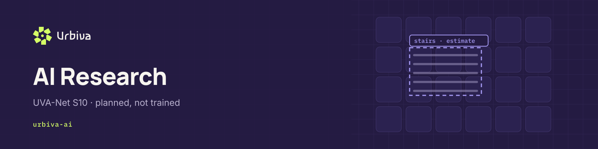

<picture>
  <source media="(prefers-color-scheme: light)" srcset="docs/images/header-urbiva-ai-light.png">
  
</picture>

# urbiva-ai

**Research and development of lightweight urban accessibility computer vision models.**

This repository is the home of **UVA-Net S10** (Urban Vision Accessibility Network, small, under 10 million parameters): a model that recognises accessibility barriers in street photos and runs locally, without depending on an external vision API.

> **Status: implemented in code, not trained.** The architecture, data pipeline, training loop, evaluation, export and a local serving endpoint exist and are tested. There are **no datasets, no weights and no results** in this repository. Every number below is a constraint, a target or a property of the code, never a measured accuracy.

## Why

Urbiva Vision in `urbiva-app` currently sends a re-encoded photo to an external vision model and always asks a person to confirm the result. A small local model will:

- keep photos on infrastructure we control,
- give predictable latency and cost,
- let us tune for a **low false-positive rate**, because a wrongly reported barrier sends people on longer routes.

## Task

Single-image classification of the barrier category on a sidewalk or crossing, with the same taxonomy as the app:

`stairs` · `blocked_path` · `broken_surface` · `curb` · `obstruction` · `other` · `none`

## UVA-Net S10 at a glance

| Property | Value | Source |
| --- | --- | --- |
| Backbone | Inverted residual blocks, depthwise convolutions, squeeze-and-excitation, hard-swish | `src/urbiva_ai/models/uva_net.py` |
| Parameters at width 1.0 | 3,963,191 | Computed from the architecture, checked in CI |
| Largest width within budget | 1.5 (8,112,247 parameters) | Widths from 1.75 are refused |
| Input | 320 x 320 RGB, letterboxed, EXIF removed | `src/urbiva_ai/data/transforms.py` |
| Output | 7 class probabilities, mapped to the app contract | `src/urbiva_ai/inference/contract.py` |
| Operating point | Threshold chosen on validation for a target false-positive rate (default 5 %) | `src/urbiva_ai/evaluation/metrics.py` |
| Serving | Local `POST /api/vision`, same request and response as the app | `src/urbiva_ai/inference/server.py` |

## Constraints and targets

| Item | Value | Type |
| --- | --- | --- |
| Model size | at most 10 million parameters | Hard constraint, enforced in code |
| GPU budget | about 10 GH200 GPU-hours | Allocation; the trainer stops before its configured share is used |
| CPU budget | about 20 to 30 CPU-hours | Allocation; billing interpretation still to be verified |
| Initial dataset | about 40,000 suitable annotated images | Target |
| Quality | low false-positive rate; strong precision and recall | Goal, thresholds not yet set |

Details: [docs/compute-budget.md](docs/compute-budget.md).

## Getting started

Requires Python 3.10 or newer.

```bash
pip install -e ".[dev]"                                        # core, tests and lint
pip install torch --index-url https://download.pytorch.org/whl/cpu   # model, training, serving with a model
pytest                                                          # run the test suite
urbiva-ai validate-config configs/uva_net_s10.template.yaml
urbiva-ai params --width 1.0
```

### Commands

| Command | What it does | Needs |
| --- | --- | --- |
| `urbiva-ai validate-config CONFIG` | Checks a configuration against every constraint | core |
| `urbiva-ai validate-manifest MANIFEST --sources SOURCES` | Checks records, licences, privacy flags and duplicates | core |
| `urbiva-ai params --width W` | Counts parameters and reports the budget check | torch |
| `urbiva-ai train CONFIG --sources SOURCES` | Trains with seeding, early stopping and the GPU-hour guard | torch, data |
| `urbiva-ai evaluate CHECKPOINT` | Writes `report.json` and `report.md` from measured predictions | torch, data |
| `urbiva-ai export CHECKPOINT` | Exports ONNX for CPU serving | torch, onnx |
| `urbiva-ai serve [--checkpoint CKPT]` | Serves `POST /api/vision`; answers `not_configured` without a model | core (torch with a model) |

## Repository structure

```
configs/        Experiment configuration (valid template)
datasets/       Provenance, licence register, example schema files; no images
docs/           Architecture, compute budget, data strategy, evaluation, reproducibility, roadmap
experiments/    One folder per experiment with config, notes and results
models/         Model cards only; weights are never committed
notebooks/      Exploration notebooks
scripts/        Helper entry points
src/urbiva_ai/  labels, config, data, models, training, evaluation, inference, cli
tests/          Unit tests (torch tests run in CI)
```

## Documentation

| Document | Purpose |
| --- | --- |
| [Architecture goals](docs/architecture-goals.md) | Design of UVA-Net S10 and open questions |
| [Compute budget](docs/compute-budget.md) | GPU and CPU allocation, how it is spent and guarded |
| [Dataset strategy](docs/dataset-strategy.md) | Sources, annotation, privacy, splits |
| [Evaluation methodology](docs/evaluation.md) | Metrics, false-positive focus, test protocol |
| [Reproducibility standards](docs/reproducibility.md) | Seeds, configs, environment, reporting |
| [Research roadmap](docs/roadmap.md) | Milestones from data audit to integration |
| [Dataset provenance template](datasets/templates/PROVENANCE.md) | One record per dataset source |
| [Dataset licence register](datasets/LICENSES.md) | Licence of every source, checked before use |

## Research principles

- **No fabricated results.** Only report metrics produced by a committed config on a recorded dataset version.
- **Provenance first.** The manifest validator rejects any record without a registered source and a licence that permits commercial use.
- **Privacy by design.** Records must confirm that faces and licence plates are blurred; preprocessing removes metadata.
- **No leakage.** Splits are assigned by location group, so one place never appears in two splits.
- **Human in the loop.** Every result carries `requiresHumanReview: true`; the app keeps human confirmation.

## Status

| Area | State |
| --- | --- |
| Code | Implemented and tested |
| Data | None collected |
| Training | Not started |
| Weights | None |
| Results | None |

## Contributing

Use `feat/*`, `fix/*`, `docs/*` and `chore/*` branches and open pull requests into `main`. Run `make check` before pushing. Never commit datasets, weights, credentials or personal data. See the organization-wide contributing guide in `urbiva/.github`.

## Urbiva repositories

| Repository | Purpose |
| --- | --- |
| [`urbiva-app`](https://github.com/urbiva/urbiva-app) | Application: Go, Vision, Urban and Impact |
| **urbiva-ai** | UVA-Net S10: code for a local vision model, not yet trained |
| [`urbiva-brand`](https://github.com/urbiva/urbiva-brand) | Logo package, tokens, guidelines and GitHub brand kit |
| [`urbiva-docs`](https://github.com/urbiva/urbiva-docs) | Product specifications, architecture, decisions and roadmap |

## License

Copyright (c) 2026 the members of the team "Maximilian". All rights reserved.

This repository is public so that it can be read. It is **not open source**. Use, copying, modification, distribution and training of AI systems on it are not permitted except as stated in the [Urbiva Proprietary License 1.0](LICENSE). Third-party components are listed in [NOTICE](NOTICE); dataset licences are tracked in [datasets/LICENSES.md](datasets/LICENSES.md).
